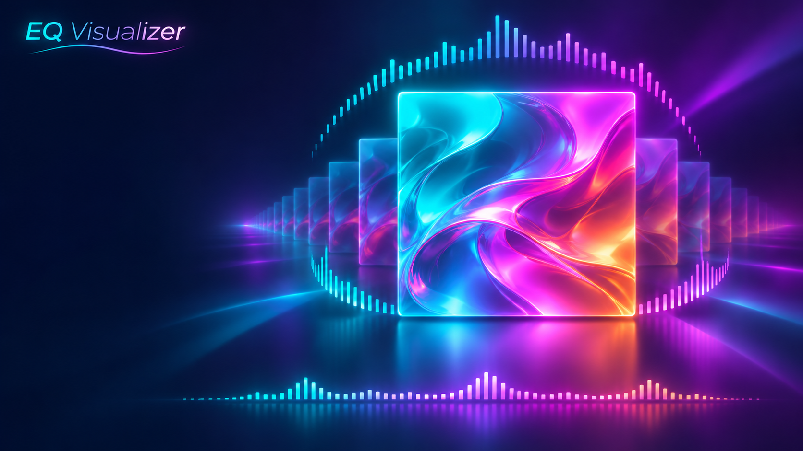

# EQ Visualizer 🎶

### Tu música. Tu portada. Un escritorio con vida.

**Wallpaper musical para Windows 11 x64**

[Características](#características) · [Personalización](#personalización) · [Primeros pasos](#primeros-pasos) · [Compatibilidad](COMPATIBILITY.md)

Ilustración conceptual. La apariencia del fondo se adapta a la portada y a la paleta de la canción activa.

## ✨️Un escritorio que acompaña tu música✨️

EQ Visualizer transforma el fondo de Windows en una escena musical con portada, título, artista y barras que reaccionan al sonido. Los colores de cada canción dan forma al ambiente, con desenfoque, profundidad y movimiento configurables.

Su motor de escritorio integra la escena detrás de los iconos de Windows. Desde una composición discreta alrededor de la portada hasta una franja que recorre la pantalla, EQ permite adaptar el visualizador al espacio de trabajo.

> **Beta pública 1.0.0 (Windows 11 x64):** descarga el [EXE](https://github.com/TKGHyper42/EQ-Visualizer/releases/download/EQ-VisualizerV1/EQVisualizer-win-x64.exe) o el [ZIP portátil](https://github.com/TKGHyper42/EQ-Visualizer/releases/download/EQ-VisualizerV1/EQVisualizer-win-x64.zip). También están disponibles las [notas de la versión](https://github.com/TKGHyper42/EQ-Visualizer/releases/tag/EQ-VisualizerV1) y las [sumas SHA-256](https://github.com/TKGHyper42/EQ-Visualizer/releases/download/EQ-VisualizerV1/SHA256SUMS.txt). Es una beta: consulta los requisitos y la compatibilidad antes de utilizarla; todavía no es una versión estable certificada.

## 🎛 Características

- **Tu música en primer plano.** Portada, título y artista a partir de las sesiones multimedia compatibles de Windows, como las de Spotify o YouTube en un navegador que publique esa información.
- **Dos estilos de visualizador.** Barras circulares alrededor de la portada, franja inferior o ambos estilos a la vez.
- **Colores que acompañan cada canción.** Degradados basados en la portada, con modos de paleta, paleta invertida, puntas claras y color sólido, además de intensidad ajustable.
- **Profundidad y movimiento.** Túnel de anillos en perspectiva, paralaje del cursor y desenfoque del fondo, conservando la portada y el texto nítidos.
- **Un fondo también para las pausas.** Reloj digital o analógico, imagen local, combinación de ambos o conservación de la portada cuando no hay música.
- **Control desde la bandeja.** Acceso a Ajustes, selección de reproductor, fuente de audio y modos del visualizador.
- **Rendimiento configurable.** Límite de FPS, escala interna y motor Direct3D 11 con alternativa GDI+ de compatibilidad.
- **Diagnóstico en tiempo real.** El panel Debug muestra FPS, estado y motor por monitor, junto con el uso de CPU y memoria del proceso.

## 🖥Personalización

Cada estilo de barras tiene controles independientes para ajustar la composición.

| Elemento | Opciones |
| --- | --- |
| **Visualizador circular** | Altura, grosor, opacidad y extremos redondos o cuadrados |
| **Franja inferior** | Altura, grosor, opacidad, extremos y anchura sobre la pantalla |
| **Color de las barras** | Modo de degradado e intensidad |
| **Portada** | Tamaño y posición |
| **Título y artista** | Opacidad del recuadro independiente del texto y sombra opcional |
| **Fondo** | Desenfoque, túnel y paralaje |
| **Modo sin música** | Reloj digital o analógico, imagen local y comportamiento durante las pausas |
| **Interfaz** | Temas claros y oscuros, color de acento y transparencia |

Los deslizadores permiten afinar los valores y comprobar la composición en una vista previa. **Guardar cambios** aplica los ajustes y mantiene la ventana abierta para continuar personalizando. La vista previa utiliza una señal simulada; el fondo utiliza la fuente de audio seleccionada.

## ✅️Requisitos

- **Windows 11 x64.** Es la única plataforma de soporte de esta versión.
- Una salida de audio disponible para el análisis del sonido.
- Una aplicación que comparta su sesión multimedia con Windows para mostrar portada, título y artista.

El ejecutable autocontenido incluye el entorno .NET necesario. No requiere instalar un runtime adicional ni iniciar sesión en una cuenta de Spotify desde EQ.

Los detalles sobre aplicaciones compatibles, captura de audio y limitaciones están en [Compatibilidad](COMPATIBILITY.md).

## ➡️Primeros pasos

1. Ejecuta EQ Visualizer desde la carpeta donde se encuentre la distribución portátil.
2. En **Bienvenida**, elige visualizador circular, franja inferior o ambos.
3. Reproduce música en una aplicación compatible.
4. Abre **Ajustes** desde el icono de EQ en la bandeja de Windows y personaliza la escena.
5. Pulsa **Guardar cambios** para aplicar la configuración al escritorio.

El menú de bandeja reúne los controles del visualizador, la selección de audio y el panel **Debug**. La opción **Salir** cierra EQ y restaura el fondo anterior de Windows.

## 🔊Audio y reproducción

La información de la canción y el sonido que mueve las barras se seleccionan por separado:

| Control | Función |
| --- | --- |
| **Reproductor** | Selecciona la sesión multimedia que aporta portada, título y artista |
| **Capturar sonido de** | Selecciona la mezcla de salida o un proceso de audio concreto |
| **Salida de audio** | Selecciona el dispositivo que se analiza en modo de mezcla |

El modo automático de reproductor elige una sesión musical disponible. La captura de mezcla responde a los sonidos de la salida seleccionada; la captura por proceso permite elegir manualmente una aplicación. Cambiar el reproductor no cambia automáticamente el proceso de captura.

La información disponible depende de cada aplicación: si una sesión no publica portada o artista, EQ solo puede mostrar los datos que Windows proporciona.

## 📄Rendimiento

EQ incluye controles de FPS y resolución interna para adaptar el renderizado al equipo. La animación puede pausarse en los monitores cubiertos por una ventana maximizada o a pantalla completa, sin detener la música.

Direct3D 11 es el motor principal. GDI+ ofrece una alternativa de compatibilidad que utiliza CPU; su consumo depende de la resolución y del límite de FPS. El panel **Debug** permite observar el rendimiento mientras se ajusta la configuración.

## 📑Privacidad

El análisis de audio se realiza localmente. EQ no graba canciones, no transmite audio y no guarda historial musical. Las preferencias se almacenan en el equipo, sin conservar títulos, artistas, portadas ni muestras de audio en el archivo de ajustes.

## Licencia

EQ Visualizer se distribuye bajo la [licencia MIT](LICENSE).

Creado por **TKGHyper42**

