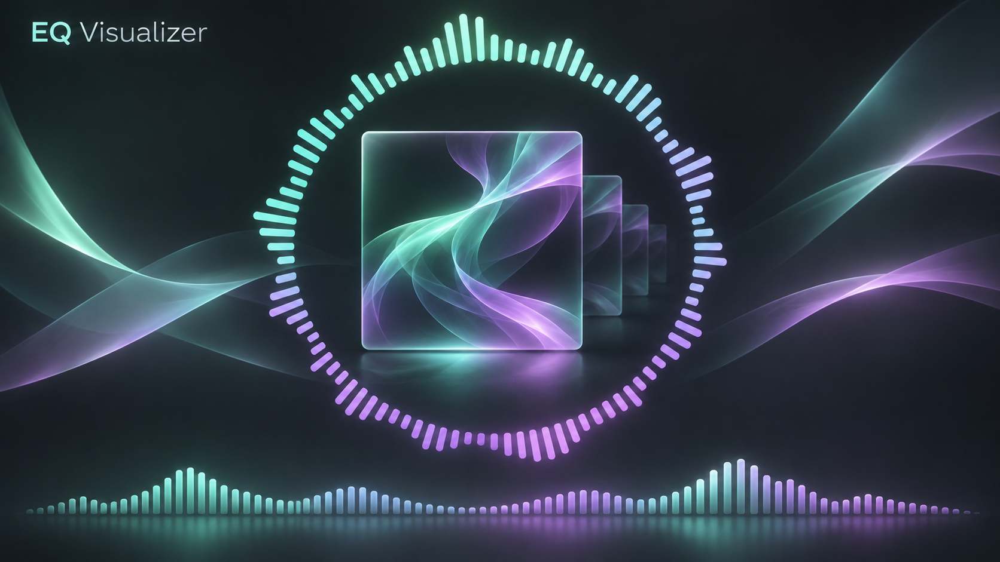

# EQ Visualizer

### Tu música. Tu portada. Un escritorio con vida.

Tu música ya suena. Ahora también puede transformar tu escritorio.

**Windows · Música · Portadas · Personalización**

Ilustración conceptual. El wallpaper toma su imagen y sus colores de la música que escuchas.

---

## 🎵 Dale vida a tu música

EQ Visualizer es un wallpaper musical para Windows que acompaña lo que ya reproduces en tus aplicaciones. Cuando Windows comparte una sesión musical compatible, su portada, título y artista se convierten en el punto de partida de tu escritorio.

La imagen gana profundidad, sus colores envuelven el fondo y el visualizador reacciona al sonido que elijas analizar. Todo se integra detrás de los iconos: tu música sigue en su reproductor y tu escritorio sigue siendo tuyo.

## ✨ Hecho para tu estilo

- **La portada como protagonista.** Un fondo inspirado en la canción, con un recorrido continuo entre sus imágenes.
- **Movimiento que se siente.** Profundidad y paralaje suave al mover el cursor, con la opción de desactivarlos.
- **Círculo, franja o los dos.** Rodea la portada con el visualizador, colócalo sobre la barra de tareas o combina ambas formas.
- **Todo en su sitio.** Ajusta posición, tamaño, intensidad y suavidad hasta encontrar tu combinación. Mira el resultado en la vista previa antes de guardar.
- **Una interfaz muy tuya.** Explora temas claros y oscuros, elige el acento y ajusta la transparencia. Carbón ofrece un aspecto negro y gris; Aurora añade tonos melocotón y lila.
- **Control al instante.** Activa tus efectos desde la bandeja del sistema o con tus propios atajos de teclado.
- **Tu canción a la vista.** Muestra u oculta el título y el artista debajo de la portada.
- **También cuando hay silencio.** Si no hay sesión musical, puedes mostrar un reloj digital redondeado o analógico circular, una imagen de tu equipo o ambos.
- **Una pausa cuando hace falta.** La animación descansa cuando el escritorio queda cubierto y vuelve cuando lo necesitas.

Ilustración del wallpaper, no una captura de la interfaz de Ajustes. No incluye canciones ni portadas de terceros.

## 🚀 Empieza a escuchar

### 1. Abre EQ Visualizer

Descarga el ZIP para tu equipo desde [Releases](https://github.com/TKGHyper42/EQ-Visualizer/releases), extráelo completo y ejecuta **EQVisualizer.exe**. Encontrarás su icono junto al reloj de Windows.

Usa **x64** en Windows 11 y Windows 10 de 64 bits. La versión **x86** está destinada a Windows 10 de 32 bits, con soporte limitado. Consulta la [compatibilidad](COMPATIBILITY.md) antes de instalar.

### 2. Pon tu música

Reproduce una canción en tu aplicación de música. Si tienes varias sesiones, elige la que quieres seguir en **Reproductor**, desde la bandeja. Algunas aplicaciones no comparten una sesión compatible o no ofrecen portada.

En **Capturar sonido de** elige la salida completa o una aplicación compatible con captura aislada. La salida completa también puede incluir sonidos de otras aplicaciones. La elección del sonido y la del reproductor son independientes.

### 3. Dale tu toque

Abre **Ajustes** desde la bandeja. Usa los deslizadores para ajustar el tamaño, la posición y la intensidad, o escribe un valor en el campo junto al control. Comprueba la composición en la vista previa y pulsa **Guardar cambios** cuando te guste el resultado. La vista previa usa una señal simulada.

Haz doble clic en el icono de la bandeja para abrir Ajustes. En el menú del icono puedes elegir **Crear acceso directo en el escritorio**. El acceso abre Ajustes en la instancia que ya está en ejecución.

La barra superior de Ajustes permite minimizar, maximizar, restaurar y cerrar la ventana.

### 4. Disfruta

Sigue trabajando, escuchando o descansando. Puedes activar o desactivar los efectos cuando quieras y salir desde el menú de la bandeja.

## 🎛️ Encuentra tu combinación

| Si prefieres… | Prueba… |
| --- | --- |
| Un escritorio tranquilo | Movimiento suave y un visualizador pequeño |
| Que la portada destaque | El visualizador alrededor de la imagen |
| Más espacio para tus archivos | Una franja de audio sobre la barra de tareas |
| Menos movimiento | Desactivar el paralaje y reducir la intensidad |
| Una experiencia más fluida | Ajustar el límite de FPS a tu equipo |

## 🔒 Tu música se queda contigo

EQ Visualizer analiza el sonido para crear los efectos. No graba tus canciones, no transmite el audio y no guarda tu historial musical. Tampoco necesitas iniciar sesión en Spotify ni compartir contraseñas.

La imagen personalizada permanece en tu equipo. El programa solo recuerda la ubicación que elegiste.

La captura aislada y la integración con el escritorio dependen de la versión de Windows y de la aplicación musical. Encontrarás los requisitos y las limitaciones en la [guía de compatibilidad](COMPATIBILITY.md).

## 💜 Hecho para disfrutar el escritorio

Una canción puede cambiar el ambiente de una habitación. EQ Visualizer lleva esa misma idea a tu pantalla.

---

Creado por **TKGHyper42** · [Licencia MIT](LICENSE)

